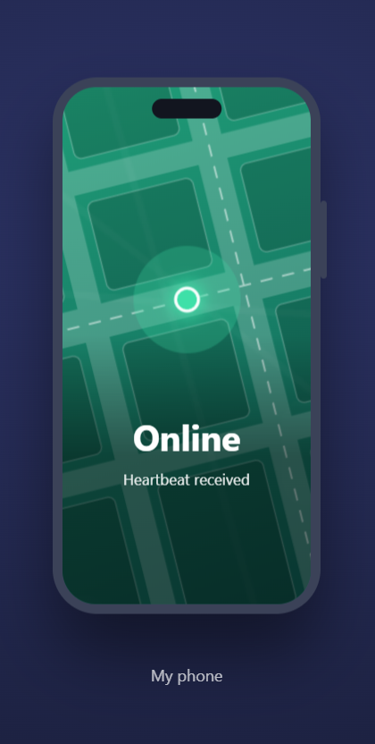
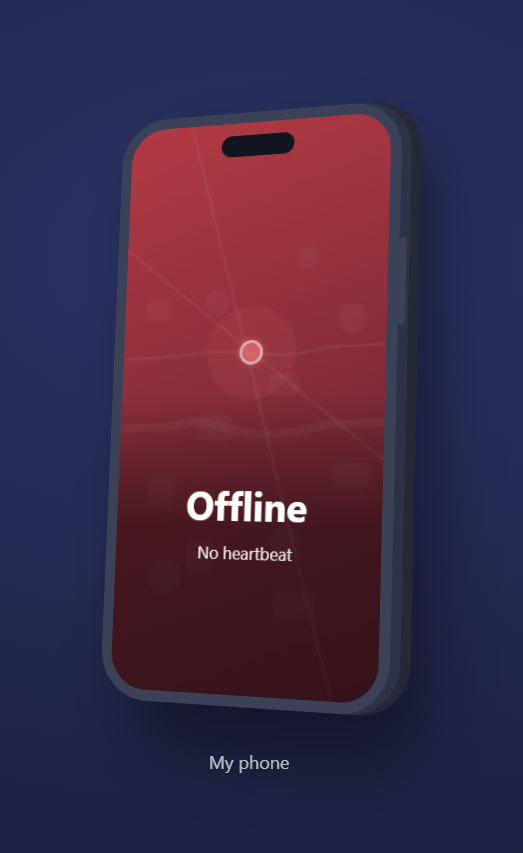

# Online Status Checker

A Java-based TCP socket programming project that monitors whether my phone is online or offline in real time.

The system uses a heartbeat mechanism in which the phone periodically sends signals to a server running on my laptop. The server detects connection changes, records every status transition in an SQLite database, and displays the phone's current status on a live web dashboard.

## How It Works

The project consists of three main components:

- **HeartbeatClient:** Runs on the Android phone through Termux. It establishes a TCP connection with the server on port `5000` and sends a heartbeat every 2 seconds. If the connection drops, it automatically attempts to reconnect.
- **StatusServer:** Runs on the laptop and listens for incoming TCP connections. It marks the phone as **Online** when a connection is established and **Offline** when the connection closes or no heartbeat is received for 5 seconds.
- **SQLite Database:** Every status transition is recorded in a database table named `status_log`, allowing previous online and offline events to be reviewed.

The server also hosts a lightweight HTTP web server on port `8080`. It serves `server/index.html`, which periodically checks the phone's current status every 2 seconds.

## Web Dashboard and Visual Behaviour

The dashboard provides a visual representation of the phone's connection status through animated transitions.

### 1. Online Status
- The dashboard displays a green screen.
- The phone illustration smoothly straightens and faces the viewer.
- The status indicator pulses like a heartbeat.
- The background map zooms in from a broad overview to a closer view showing wider roads and larger building blocks.

### 2. Offline Status
- The dashboard displays a red screen.
- The phone illustration tilts backwards.
- The heartbeat animation stops.
- The background map zooms back out to its wider overview.

### 3. Server Unavailable
- The dashboard displays a grey screen when the server cannot be reached.

**Important:** The background map is purely decorative. It is an abstract visual representation and does not display actual geographical information. The server does not collect, access, or track the phone's location.

## Web Dashboard Screenshots

The following screenshots demonstrate how the dashboard visually responds to changes in the phone's connection status.

### Phone Online



### Phone Offline



## Project Structure

```text
status-checker/
│
├── client/
│   └── HeartbeatClient.java
│
├── server/
│   ├── StatusServer.java
│   ├── ViewLog.java
│   ├── index.html
│   └── lib/
│       └── sqlite-jdbc.jar
│
├── docs/
│
└── README.md
```

## Requirements

Before running the project, make sure the following are installed:

- **Java 17** or later.
- **SQLite JDBC Driver:** Download the `sqlite-jdbc` JAR file from the [Xerial SQLite JDBC Releases](https://github.com/xerial/sqlite-jdbc/releases) page.
- Place the downloaded JAR file inside the `server/lib/` directory.

## Running the Project

### Step 1: Start the Server

Open a terminal inside the `server/` directory.

On Windows, compile and run the server using:

```bash
javac StatusServer.java ViewLog.java

java -cp ".;lib/sqlite-jdbc-<version>.jar" StatusServer
```

Replace `<version>` with the actual version of the downloaded SQLite JDBC JAR file.

### Step 2: Start the Client

Open another terminal inside the `client/` directory.

Compile the client:

```bash
javac HeartbeatClient.java
```

Run the client by providing the server's IP address:

```bash
java HeartbeatClient <server-ip>
```

For an Android phone, run the compiled client through Termux, ensuring that the phone can reach the laptop over the network.

### Step 3: Open the Web Dashboard

Open your browser and navigate to:

```text
http://localhost:8080
```

The dashboard will display the phone's current connection status.

### Step 4: View the Status History

To view previously recorded online and offline events, run:

```bash
java -cp ".;lib/sqlite-jdbc-<version>.jar" ViewLog
```

**Note:** On Linux and macOS, use `:` instead of `;` as the classpath separator.

## Concepts and Technologies Covered

This project demonstrates several fundamental networking and software development concepts:

- TCP/IP communication and socket programming.
- Client-server architecture.
- Network ports and connection management.
- Heartbeat mechanisms and timeout detection.
- Automatic reconnection and error handling.
- NAT, private IP addresses, and local network communication.
- SQLite database integration.
- JDBC and `PreparedStatement`.
- Event logging and status tracking.
- Basic HTTP server implementation.
- HTML, CSS, JavaScript, and periodic status polling.

## Testing and Verification

The project has been tested under several scenarios to verify its functionality and reliability:

1. **Normal Connection:** Verified that the server correctly identifies the phone as online.
2. **Client Shutdown:** Verified that stopping the client changes the status to offline.
3. **Heartbeat Timeout:** Tested whether the server detects a missing heartbeat after the configured timeout.
4. **Database Logging:** Confirmed that status transitions are recorded in SQLite.
5. **Web Dashboard:** Verified that the dashboard updates automatically.
6. **Phone over Wi-Fi:** Tested communication between the Android phone and laptop over the same Wi-Fi network.
7. **Wi-Fi Disconnection and Recovery:** Tested connection loss and subsequent recovery. This test revealed a reconnection issue, which was resolved by implementing an automatic reconnect loop.

Additional testing details and observations are documented in the `docs/` directory.

## Current Limitations and Future Improvements

### Current Limitations
- Supports only one client connection at a time.
- Designed for local network communication.
- Does not currently implement authentication or encryption.
- Requires the server to be running and accessible for monitoring to work.

### Planned Improvements
- Support multiple devices simultaneously.
- Introduce client authentication.
- Implement secure communication.
- Add more detailed connection history and analytics.
- Explore remote monitoring beyond the local network.

---

**Project Name:** Online Status Checker  
**Language:** Java  
**Networking:** TCP Sockets  
**Database:** SQLite  
**Frontend:** HTML, CSS, JavaScript  
**Environment:** Java 17, Android (Termux), Windows/Linux/macOS
